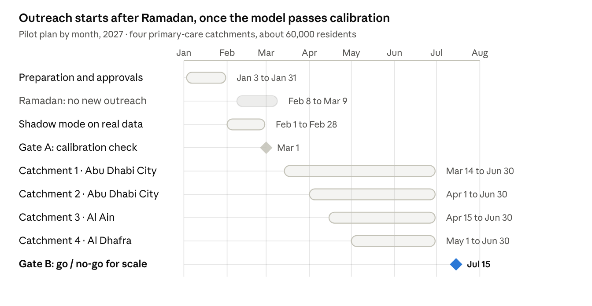

# S.C.O.P.E Business Case and Pilot Plan

Dr Guy Dieudonné Mvogo Eloundou · November 2026

## Executive summary

S.C.O.P.E roughly doubles the number of high-risk people reached by preventive outreach in Abu Dhabi, with the same outreach team, for an estimated AED 2 per covered resident per year.

Today, invitations to Well-Child Visits, immunisation and IFHAS screening follow age and sex rules. S.C.O.P.E adds the DoH standards, calibrated risk, family links and consented genomic results, then plans one Family Health Day per household and invites the family in its own language on WhatsApp.

In a simulation on a synthetic Abu Dhabi population, at an equal budget of 600 people contacted per 90-day cycle, S.C.O.P.E reached 74 high-risk people against 36 for age and sex rules, and found 16 undiagnosed diabetes cases against 7. With the tailoring effects halved, the gain is still about 1.7 times.

**The ask:** a 6-month pilot in four primary-care catchments (about 60,000 residents) with DoH/ADPHC, linked to Malaffi, with Daman as the second payer. The licence is waived for the pilot; success is judged on completed visits and calibration on real data.

## The problem in numbers

Abu Dhabi already holds the data to predict preventive need, but outreach still runs on age and sex rules, and most of the hidden risk sits outside them.

| Indicator | Value | Source |
| --- | --- | --- |
| Abu Dhabi population, 2024 | 4,135,985 residents, up 7.5% in a year | [SCAD](https://scad.gov.ae/w/abu-dhabi-population-in-2024-grows-7-5-to-reach-4-14m) |
| Adults 20–79 with diabetes, UAE | 20.7% (age-adjusted) | [IDF Diabetes Atlas 2024](https://diabetesatlas.org/data-by-location/country/united-arab-emirates/) |
| Share of those cases undiagnosed | 64% | [IDF Diabetes Atlas 2024](https://diabetesatlas.org/data-by-location/country/united-arab-emirates/) |
| Health spending per person with diabetes | USD 1,583.5 a year | [IDF Diabetes Atlas 2024](https://diabetesatlas.org/data-by-location/country/united-arab-emirates/) |
| Malaffi health information exchange | 12.7 million patient profiles, 3,072 facilities, 3.5 billion records (Aug 2025) | [M42](https://m42.ae/media-resources/news/malaffi-reaches-35-billion-clinical-records-setting-a-new-standard-for-healthcare-innovation-in-abu-dhabi/) |
| IFHAS adult screening | Thiqa holders aged 18 to 75 only | [ADPHC](https://www.adphc.gov.ae/en/Public-Health-Programs/IFHAS) |

Three gaps follow from this. Children and adults with elevated risk are invited at the same time as everyone else, or not at all. Families receive separate invitations for each member, so each visit competes with work and school. Expatriate adults outside Thiqa have no funded comprehensive screening pathway; in the synthetic population that is 942 of 2,711 adults.

## Value by stakeholder

Each party gets a measurable result it is already accountable for, so S.C.O.P.E can be paid from existing programme budgets rather than a new line.

| Stakeholder | What they get | Measure they already report |
| --- | --- | --- |
| DoH and ADPHC (programme owner) | More completed Well-Child Visits, M-CHAT-R screens, immunisations and IFHAS packages from the same outreach effort; an equity audit by segment; a FHIR feed into the Population Health Intelligence work | WCV attendance by age, M-CHAT-R uptake (target 100%), IFHAS completion |
| Daman / Thiqa (payer) | Earlier detection of diabetes and familial hypercholesterolaemia among members; fewer duplicate screens through claims-aware invitations | Screening completion, avoidable admissions, cost per member |
| Providers (SEHA/PureHealth, M42, private clinics) | Bundled family visits that fill clinic slots predictably; a ready worklist per clinician | No-show rate, slot utilisation, KPI compliance |
| Families | One visit for several members, at a time that fits school, work and Ramadan, in their own language, with clear data choices | Satisfaction, opt-out rate |
| Employers and insurers of expatriates | A route to community screening for workers with no funded pathway | Screening coverage of insured workers |

## Business model and pricing

S.C.O.P.E is licensed per covered resident per year, with part of the fee tied to outcomes, so the payer pays more only when more preventive care is actually delivered.

| Component | Proposed price | Paid by | Notes |
| --- | --- | --- | --- |
| Platform licence | AED 2 per covered resident per year | DoH/ADPHC | Rules, risk, family planning, equity audit, FHIR API, console; about AED 8.3 million a year at full emirate scale (4.14 million residents) |
| Outcome fee | AED 10 per verified completed preventive action above the pre-launch baseline | Daman / Thiqa, or the programme owner | Counted from claims and Malaffi records; capped per year |
| Messaging | Pass-through at Meta's rate | Programme owner | UAE utility template USD 0.0157 per message ([SleekFlow, Meta rates](https://sleekflow.io/blog/whatsapp-business-price-uae.md)); about USD 70 a year per 10,000 residents |
| Expatriate community screening | Per screened worker, priced with the insurer or employer | Insurers, employers | Uses the mobile-clinic routing already in the prototype |
| Pilot | Licence waived | — | Implementation funded from the award and the DoH pilot pathway |

These prices are working assumptions for negotiation, not quotes. They sit far below the per-person cost of the conditions found: a year of diabetes care costs USD 1,583.5 per person ([IDF](https://diabetesatlas.org/data-by-location/country/united-arab-emirates/)).

## Cost and return

For every 10,000 residents, a licence of AED 20,000 a year buys about 33 extra undiagnosed diabetes cases found and 143 extra high-risk people reached, because the outreach team stays the same size and only its targeting changes.

| Extra outcome per 10,000 residents per year | Base case | Tailoring effects halved | Licence cost per extra outcome (base / halved) |
| --- | --- | --- | --- |
| High-risk people reached | 143 | 91 | AED 140 / AED 219 |
| Care gaps closed | 1,157 | 467 | AED 17 / AED 43 |
| Autism screens (M-CHAT-R) completed | 112 | 69 | AED 179 / AED 288 |
| Children brought up to date on vaccines | 85 | 27 | AED 234 / AED 742 |
| Undiagnosed diabetes found | 33 | 19 | AED 602 / AED 1,042 |

Finding one undiagnosed diabetes case costs about AED 602 in licence fees, roughly a tenth of the USD 1,583.5 (about AED 5,815) spent each year on a person living with diabetes ([IDF](https://diabetesatlas.org/data-by-location/country/united-arab-emirates/)). We do not claim that figure as a saving; the case for value is earlier treatment at a low cost per case found.

Family genetic follow-up adds value not counted above. A 2024 review found 84% of studies judged familial hypercholesterolaemia screening potentially cost-effective, with cascade screening at a pooled USD 49,630 per QALY ([Global Health Research and Policy](https://ghrp.biomedcentral.com/articles/10.1186/s41256-024-00382-x)).

**How the numbers were built.** Simulated gains at equal outreach capacity (600 people per 90-day cycle on 5,416 synthetic residents, 200 runs), scaled to 10,000 residents and four cycles a year, then halved to allow for gaps being used up over repeated cycles. All results come from synthetic data; the pilot replaces them with measured values.

## Competitive landscape

S.C.O.P.E is built to complement the DoH–Microsoft Population Health Intelligence framework rather than compete with it: it is the family-level workflow that turns a prediction into a completed visit.

The framework signed in April 2025 has two pillars, Predict and Prevent and Act, and targets chronic disease prevention, early detection and health equity ([DoH](https://www.doh.gov.ae/en/news/doh-signs-a-memorandum-of-understanding-with-microsoft-to-create-an-ai-powered-phif-)). The announcement mentions neither family-level planning nor genomics, which is where S.C.O.P.E adds most.

| Capability | Age/sex reminder rules (today) | Generic population health platforms | S.C.O.P.E |
| --- | --- | --- | --- |
| Eligibility from DoH standards (WCV, immunisation, IFHAS) | Partly | Configured per client | Built in, with source on every flag |
| Unit of outreach | Individual | Individual | Household: one Family Health Day |
| Consented genomic cascade (FH, HBOC, Lynch) | No | Rarely | Yes, index-mediated, no disclosure |
| Arabic and five South Asian and Filipino languages | Arabic, English | Usually English-first | Seven languages, voice notes |
| Equity floor and small-cell suppression | No | Reporting only | Allocation and audit |
| FHIR R4 interface for Malaffi | Varies | Varies | Yes, with audit trail |

The middle column is our assessment of typical products, not a review of named vendors.

## Pilot plan

A 6-month stepped-wedge pilot in four primary-care catchments starts with a month of scoring real data without contacting anyone, then switches one catchment on at a time, so each catchment is its own comparison before activation.

The schedule keeps the first outreach clear of Ramadan and starts on 14 March, when the post-Eid relaunch window opens. Catchments not yet activated keep current practice and serve as the comparison.

**Partners sought:** ADPHC primary care (programme owner), Malaffi (data), Daman (claims and second payer), one provider group for the Family Health Day clinics, and a messaging partner with a verified WhatsApp Business sender.

| Success criterion (proposed) | Threshold at Gate B |
| --- | --- |
| Calibration on real data, per major segment | Predicted/observed ratio within 0.8–1.25, or 95% interval including 1 |
| Completed Well-Child Visits at scheduled age | Higher than in not-yet-activated catchments |
| M-CHAT-R uptake at 18 and 24 months | At least 90% (DoH target 100%) |
| IFHAS completion among invited Thiqa adults | Higher than the pre-launch baseline |
| Positive M-CHAT-R referred within the WCV timelines | 100% |
| Opt-out rate after invitation | Below 5% |
| Privacy or security incidents | None |
| Family satisfaction with the Family Health Day | At least 4 out of 5 |

## Scale path

After the pilot, S.C.O.P.E scales emirate-wide on existing infrastructure, then to other health systems that share its starting conditions.

1. **Abu Dhabi, full scale (year 2).** All primary-care catchments, through Malaffi and the FHIR API. A full nightly refresh of 3.8 million people takes under a minute on one processor core in our benchmark, so compute is not the constraint; clinic capacity and staff training are.
2. **Other emirates (year 3).** The rule base swaps per regulator (DHA, MOHAP); the family, consent and equity layers stay the same.
3. **GCC (years 3–4).** Systems with national genomic programmes, high consanguinity and multilingual expatriate populations face the same problem.
4. **Low- and middle-income settings.** The WhatsApp-first design, voice notes and community-clinic routing already work without a national data exchange. A lighter version can run on vaccination and antenatal registers, for example in sub-Saharan Africa.

## Risks and mitigations

The largest risk is that real-data performance falls short of the simulation; the pilot is designed to find that out early and cheaply.

| Risk | Effect | Mitigation |
| --- | --- | --- |
| Model underperforms on real Malaffi data | Wrong people prioritised | One month in shadow mode before any outreach; per-segment recalibration; go/no-go gate on calibration |
| Tailoring effects smaller than assumed | Smaller gains | Business case still holds at half effects (about 1.7 times); effects measured in the pilot, not assumed |
| Data-sharing approval takes longer | Pilot start slips | Start with data the programme already holds (WCV, immunisation, IFHAS claims); add genomics once approved |
| Clinic capacity for bundled visits | Families booked, slots missing | Slot planner capped per clinic per day; providers co-design the Family Health Day |
| Message fatigue or distrust | Opt-outs rise | Verified sender, no health detail in messages, four reply options, opt-out monitored weekly |
| Translation quality | Misunderstood invitations | Native-speaker and clinical review before launch; family feedback in the first cycle |
| Equity harm in a segment | Some groups under-served | Equity floor by language and nationality; audit before each cycle; small-cell suppression |

## Team and clinical leadership

The project is led by a medical biologist with a PhD in public health, head of a health sciences department, who leads clinical validation of the rule base and the pilot evaluation.

## Sources

- [SCAD: Abu Dhabi population 2024](https://scad.gov.ae/w/abu-dhabi-population-in-2024-grows-7-5-to-reach-4-14m)
- [IDF Diabetes Atlas: United Arab Emirates](https://diabetesatlas.org/data-by-location/country/united-arab-emirates/)
- [M42: Malaffi reaches 3.5 billion clinical records](https://m42.ae/media-resources/news/malaffi-reaches-35-billion-clinical-records-setting-a-new-standard-for-healthcare-innovation-in-abu-dhabi/)
- [ADPHC: IFHAS programme](https://www.adphc.gov.ae/en/Public-Health-Programs/IFHAS)
- [DoH: Population Health Intelligence framework with Microsoft](https://www.doh.gov.ae/en/news/doh-signs-a-memorandum-of-understanding-with-microsoft-to-create-an-ai-powered-phif-)
- [SleekFlow: WhatsApp Business pricing in the UAE](https://sleekflow.io/blog/whatsapp-business-price-uae.md)
- [Global Health Research and Policy: cost-effectiveness of FH screening](https://ghrp.biomedcentral.com/articles/10.1186/s41256-024-00382-x)
- [UAE government portal: health insurance and Thiqa](https://u.ae/en/information-and-services/health-and-fitness/Healthcare-access-and-insurance/Getting-a-health-insurance)
- [DoH: Standard for Well-Child Visits v10](https://www.doh.gov.ae/-/media/E3D10B966E2B431982AC28A0A6EC3A1B.ashx)
