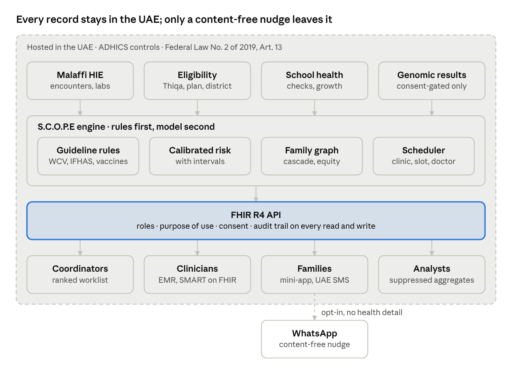

# S.C.O.P.E Technical Documentation

Dr Guy Dieudonné Mvogo Eloundou · November 2026

## Overview

S.C.O.P.E (Screening & Care Orchestration for Prevention Everywhere) finds children, adults and households in Abu Dhabi with unmet or elevated preventive need, books them into one Family Health Day with their treating physicians, invites them in their own language, and records what the clinician found and did.

The prototype covers the full loop:

1. Detect due and overdue items from the DoH standards, item by item.
2. Add calibrated, explainable risk from clinical, genomic and family data, used only with consent.
3. Rank households by preventable need under an equity floor.
4. Book each household into one session at its home clinic, treating physicians first.
5. Invite the family on its preferred channel, with no health detail in the message.
6. Give the clinician a protocol set by the visit's predictive purpose, with decision support.
7. Record the signed encounter, close the items it covers and set the next recalls.

**What is real and what is synthetic.** The rule base follows published DoH and ADPHC standards. Every person, household, clinic, clinician and outcome is synthetic: 1,350 households and 5,416 people, with headline rates anchored to published UAE figures. No real patient data is used anywhere.

| Component | Where it lives |
| --- | --- |
| Web console, family app, clinician workspace | [Live prototype](https://claude.ai/artifact/Hw8xXdNgx5Q8cG8BHWvKyp) |
| Engine, FHIR API, tests, benchmark | [GitHub: ManOfGenius/scope-future-health](https://github.com/ManOfGenius/scope-future-health) |
| Business case and pilot plan | [S.C.O.P.E Business Case and Pilot Plan](business-case.md) |

## Architecture



Records from Malaffi, eligibility, school health and (only with consent) genomic programmes feed the engine, which applies the guideline rules first and the calibrated model second, then bundles the household and books one Family Health Day with a named clinic, slot and treating physician. Every reader, human or system, reaches the result through one FHIR R4 API that checks role and purpose of use and writes an audit event. In production, clinicians open S.C.O.P.E from their EMR as a SMART on FHIR app and bookings are written to the facility's own Slot and Appointment resources, so no parallel calendar is created. The only thing that leaves the UAE-hosted boundary is an opt-in WhatsApp nudge with no health content.

## Data sources and authorised use

Each data category has one stated purpose and its own consent switch, and every score, flag and invitation records which categories it used.

| Data | Production source | Used for | Basis | Who sees detail |
| --- | --- | --- | --- | --- |
| Well-Child Visit, immunisation and IFHAS records | Malaffi health information exchange; facility EMR | Due and overdue items under the DoH standards | Programme delivery, for eligible people | Treating clinician, programme team |
| Claims and visit history | Shafafiya / insurer claims | Confirm completed screens; avoid duplicate invitations | Programme delivery | Programme team |
| Genomic results | Emirati Genome Programme; premarital and newborn screening | Family cascade invitations and familial hypercholesterolaemia risk; never adult-onset findings for minors | Explicit opt-in per person | Genetic counsellor; scores only for others |
| Family links | Family book / household registry | One visit per household; family history; cascade letters | Opt-in, revocable | Programme team |
| Social and contextual data | Address, language, distance, work pattern | Channel, language and time; equity audit | Opt-in, revocable | Outreach team |
| Outreach responses | Messaging platform | Timing and channel; honour stop requests at once | Programme delivery; STOP always honoured | Outreach team |
| Encounter records | Clinician workspace or EMR via FHIR | Close items, set recalls, measure outcomes, recalibrate | Care delivery | Treating clinician, auditors |

Withdrawing a category recalculates the person's score and confidence at once. Withdrawing genomic or family-link consent from an index person removes every cascade invitation that depended on it. Withdrawing outreach consent revokes the invitation.

## Guideline rule base

Guideline rules decide eligibility and due dates; models only order the work and never override a rule. The rule base is versioned (SCOPE-KB 1.0) and every flag carries its rule identifier, its source and the rule version.

| Standard | What is encoded | Rules |
| --- | --- | --- |
| [DoH Standard for Well-Child Visits v10 (2025)](https://www.doh.gov.ae/-/media/E3D10B966E2B431982AC28A0A6EC3A1B.ashx) | Visit schedule 1 month to 6 years with grace windows; M-CHAT-R at 18 and 24 months and referral timelines; haemoglobin at 12–18 months (below 11 g/dL needs evaluation); hearing 4–6 years; vision and blood pressure from 3 years; oral health | WCV-VISIT, WCV-MCHAT-18, WCV-MCHAT-24, WCV-MCHAT-REF, WCV-CBC-12, WCV-HEAR, WCV-VISION3, WCV-BP, WCV-ORAL |
| [DoH Circular 2026/77, immunisation schedule (Apr 2026)](https://www.doh.gov.ae/-/media/950546F00B64465CA91D7729996B3487.ashx) | Doses at 2, 4, 6, 12 and 18 months and at school grades 1, 5, 8 and 11; after age 2 missing infant doses become one catch-up review; no rotavirus after 8 months | VAX |
| [UAE National School Health Screening Guideline 2024](https://gulfnews.com/uae/health/uae-issues-new-guideline-on-school-health-screenings-what-it-covers-1.104970414) | Annual check 7–17 years: growth, vision, hearing, scoliosis, dental, wellbeing, vaccination review | SCH-ANNUAL |
| [IFHAS (ADPHC, 2025 package)](https://www.adphc.gov.ae/en/Public-Health-Programs/IFHAS) | Thiqa holders 18–75: core package every 3 years; colorectal, breast and cervical screening by age and sex; fundus, bone density, memory from the stated ages; lung LDCT 55–75 with tobacco exposure | IF-CORE, IF-CRC, IF-MAMMO, IF-CERV, IF-FUNDUS, IF-DEXA, IF-MOCA, LDCT |
| Risk-based pathways allowed by the standards | Family cascade for FH, HBOC and Lynch (index-mediated); earlier haemoglobin when both parents carry a haemoglobin variant; diabetes prevention referral; priority developmental surveillance | CASCADE-FH, CASCADE-HBOC, CASCADE-LYNCH, EARLY-CBC, DPP, DEV-PRIORITY |
| System gap | Adults outside Thiqa with no funded comprehensive screening are flagged and routed to community or insurer checks | PATHWAY-GAP |

In the synthetic population, 4,067 of 5,416 people have at least one open item: 957 overdue Well-Child Visits, 708 children with a missing or due vaccine, 374 missing or unreferred M-CHAT-R screens and 941 adults with no funded pathway.

## Models

Three logistic regression models rank the work; they were chosen over more complex learners because every score must be explained factor by factor to a clinician and a family. On synthetic data the adult model outperforms the published FINDRISC score and age alone.

| Model | Predicts | Inputs | Held-out AUC | Brier | Base rate |
| --- | --- | --- | --- | --- | --- |
| Adult cardiometabolic | Diabetes or cardiometabolic event within 3 years | 12: age, BMI, hypertension, known diabetes, family history, HbA1c band, missing HbA1c, tobacco, activity, South Asian ancestry, FH variant, genomic data missing | 0.81 | 0.090 | 12.7% |
| Child developmental | Developmental concern, 6 months to 7 years | 8: preterm birth, sex, parental consanguinity, family history, screen time, M-CHAT-R positive, M-CHAT-R missing after 18 months, family data not shared | 0.87 | 0.062 | 9.9% |
| Engagement | Attendance after a standard invitation | 6: language, distance, shift work, previous no-shows, child visit, social data not shared | 0.71 | 0.190 | 33.1% |

**Uncertainty.** Each score carries a 90% interval from 30 bootstrap refits and a data-completeness measure. Together they set a confidence label (high, medium, low, insufficient data); insufficient-data flags go to a care coordinator instead of an automated message.

**Validation against a published score** (986 held-out adults without known diabetes):

| Ranking | AUC | Future cases in the top 10% of scores |
| --- | --- | --- |
| S.C.O.P.E adult model | 0.81 | 42% |
| FINDRISC (Lindström and Tuomilehto, 2003) | 0.77 | 34% |
| Age only (current rule logic) | 0.74 | 31% |

**Calibration and recalibration.** Calibration is checked per life stage, nationality group, region, language and insurance with an exact Poisson 95% interval on observed events. A segment is acted on only when the interval excludes 1. Recalibration is an intercept offset per segment, fitted on the training fold and shrunk toward zero for small segments. On the current run, two overlapping segments need action (Arab expatriates, ratio 0.67; Enhanced insurance, ratio 0.70) and four are under watch.

**Use of ancestry.** South Asian ancestry is an input because guidelines set lower BMI thresholds for South Asian adults; its effect is shown on every score it touches and audited by segment.

**Graceful degradation.** If a model is unavailable or its calibration fails a gate, S.C.O.P.E falls back to guideline rules alone, ranked by days overdue, and says so on every screen. This follows the DoH AI policy's call for graceful degradation with automatic alerts.

## Scheduling and visit purposes

Every booked person sees a clinician chosen by role, continuity and language, at the household's home clinic, in one session shared with the rest of the family; 96% of physician visits are with the person's treating physician.

**Visit purpose.** Each open item maps to one of nine predictive purposes. The purpose sets the clinician role, the slot length and the examination protocol the clinician fills in.

| Purpose | Role | Minutes | Protocol items |
| --- | --- | --- | --- |
| Developmental surveillance | Paediatrician | 30 | M-CHAT-R score, milestones, speech, hearing concern, growth charts |
| Anaemia and haemoglobin risk | Paediatrician | 15 | Haemoglobin, MCV, diet review |
| Familial genetic risk | Family physician | 20 | Three-generation pedigree, LDL cholesterol, family letter |
| Cardiometabolic prevention | Family physician | 30 | Blood pressure, BMI, waist, HbA1c, LDL, tobacco, PHQ-2 |
| Cancer screening | Family physician | 15 | FIT, mammogram, cervical sample, shared decision |
| Routine Well-Child Visit | Paediatrician | 20 | Growth centile, vision, hearing, blood pressure, oral health, guidance |
| Immunisation catch-up | Nurse | 10 | Each due dose recorded as given |
| School-age health check | Nurse | 15 | BMI category, vision, hearing, scoliosis, wellbeing, smoking |
| Community health check | Nurse | 15 | Blood pressure, random glucose, BMI |

A person with several purposes gets one visit: the highest physician role takes the whole visit, nurse items add 5 minutes, and a visit lasts 10 to 45 minutes.

**Constraints the scheduler applies:**

- One home clinic per household and one treating physician per role per household, chosen to speak the family's language where the clinic has such a clinician.
- Sessions: Monday and Wednesday mornings, Tuesday and Thursday evenings, Friday afternoon, Saturday morning at Saturday clinics only, and evening sessions after iftar during Ramadan. No bookings on public holidays.
- Shift-work households only on Friday afternoon or Saturday; households with working adults or school-age children only in evening or weekend sessions, except during the school winter break.
- At most half of each session's minutes are booked by S.C.O.P.E; the rest stays with the clinic's own appointments.
- Treating physicians only for the first 21 days of the search window; a same-role colleague covers after that. A household that cannot be placed within 12 weeks is waitlisted for the next cycle.
- An interpreter is flagged when no clinician in the session speaks the family's language.

**Current run:** 20 clinics, 75 clinicians, 3,593 appointments for 1,186 households over 12 weeks, 49 households waitlisted. Interpreters are needed most for Urdu, Hindi, Malayalam and Bengali families, which points to recruitment and interpreter rotas.

**In production,** S.C.O.P.E proposes these bookings to each facility's own scheduling system through FHIR Slot and Appointment rather than keeping a parallel calendar (see Interoperability).

## Engagement and messaging

Health details never leave the UAE: the invitation itself lives in UAE-hosted channels, and WhatsApp carries only a content-free notification unless the DoH approves more under Article 13 of Federal Law No. 2 of 2019.

Article 13 bars storing, processing or transferring health data linked to services in the UAE outside the country, unless the health authority allows an exception ([UAE Ministry of Justice](https://elaws.moj.gov.ae/UAE-MOJ_LC-En/00_Health/UAE-LC-En_2019-02-06_00002_Kait.html?val=EL1)). An appointment at a named clinic is arguably health data, and none of the ten exemptions in the 2021 resolution clearly covers reminders ([Al Tamimi](https://www.tamimi.com/law-update-articles/setting-healthy-boundaries-regulated-exemptions-to-restrictions-on-the-transfer-the-health-data-outside-of-the-uae/)). S.C.O.P.E therefore treats it as health data.

| Channel | Hosting | What it may carry | When used |
| --- | --- | --- | --- |
| S.C.O.P.E Family mini-app (UAE PASS sign-in) | UAE region | The full family plan: who, when, where, why, data choices, family letters | Always; the home of every detail |
| SMS from a UAE-licensed operator | UAE | Date, time and clinic; never a condition or test | Default invitation and reminders |
| WhatsApp Business | Meta (outside the UAE) | Content-free notification only: "A new message from ADPHC is waiting. Open S.C.O.P.E Family", with the secure link | Only after explicit opt-in to WhatsApp |
| WhatsApp, full invitation | Meta | Date, time, clinic and reply buttons | Only if the DoH grants an exception for this use |
| Phone call or community health worker | UAE | Spoken invitation | No digital channel, low digital literacy, or no reply after two tries |

**Content rules for every channel.** No condition, result or genomic finding in any message; a verified sender; four reply choices (confirm, another time, talk to my doctor first, stop); STOP honoured at once; no messages during prayer times or fasting hours in Ramadan.

**Language and addressee.** Invitations are drafted for seven languages (Arabic, English, Urdu, Hindi, Malayalam, Tagalog, Bengali) and three addressees (parent, adult, elder decision-maker). Translations are drafts until a native speaker and a clinician review them.

**Family letters.** A relative's genetic follow-up is only ever triggered by a letter the index person chooses to send, or a parent on behalf of a carrier child. No relative is told another person's result; this matches the confidentiality duty in Article 25 of Federal Decree-Law No. 49 of 2023.

## Interoperability

Everything S.C.O.P.E produces is served as FHIR R4, so facility EMRs, Malaffi and messaging platforms can consume it without custom integration, and clinicians can work inside their own EMR.

| Operation | Returns |
| --- | --- |
| `GET /fhir/metadata` | CapabilityStatement |
| `GET /fhir/Patient/{id}/$care-gaps` | DetectedIssue per open item, ImmunizationRecommendation, RiskAssessment with interval, factors and a population-prioritisation note |
| `GET /fhir/Group/{household}/$family-plan` | Group, Task, CommunicationRequest, RelatedPerson, Appointment, Practitioner, Location, DetectedIssue, ImmunizationRecommendation |
| `GET /fhir/Appointment?patient={id}` | Appointments with Practitioner and Location |
| `PUT /fhir/Consent/{id}-{category}` | Updated Consent plus recomputed risk, confidence, priority and affected relatives |
| `POST /fhir/Appointment/{id}/$sign-encounter` | Encounter, Observation (LOINC for blood pressure, BMI, waist, HbA1c, haemoglobin, MCV, LDL, glucose), Condition (ICD-10-CM), ServiceRequest, Immunization, Procedure, ClinicalImpression |
| `GET /fhir/AuditEvent` | Every read, write and refusal (auditor role only) |

Standard terminologies are used where they exist: LOINC, ICD-10-CM, HL7 v3 RoleCode and ActReason, risk-probability, immunisation recommendation status, consent scope and BCP-47 language tags. Local codes (care gaps, visit purposes, data categories) sit under a placeholder namespace until the DoH assigns one.

**Working inside the EMR.** In production, the clinician workspace launches as a SMART on FHIR app from the facility EMR, in the patient's context. The clinician sees the visit's purpose, protocol and decision support in the EMR window, and the signed encounter is written back as the FHIR resources above.

**Facility scheduling.** S.C.O.P.E does not keep its own calendar in production. It reads free Slots from each facility's scheduling system, proposes Appointments with status `proposed`, and the facility confirms them as `booked`. The constraints in the previous section apply to the slots offered.

**Malaffi.** Clinical history, immunisations and visits come in through Malaffi's integration interfaces; completed encounters flow back the same way, so the next cycle starts from what actually happened.

## Security and access control

Every API call names who is calling and why, is checked against that role, and is written to the audit trail, including refusals.

| Role | Can do | Purpose of use (HL7 ActReason) |
| --- | --- | --- |
| Named practitioner | Read patients; sign their own appointments, or a same-role colleague's at the same clinic | TREAT |
| Clinician (generic) | Read patients, care gaps and plans | TREAT, CAREMGT |
| Care coordinator | Read patients and plans for outreach | CAREMGT, PATADMIN |
| Analyst | Aggregated, small-cell-suppressed endpoints only | PUBHLTH, HOPERAT |
| Auditor | Audit trail only | HOPERAT |
| Family member | Own household only; change own and own minors' data choices | PATRQT |

**Rules enforced in code and covered by tests:** an adult cannot change another adult's choices; a practitioner from another clinic cannot sign; signing needs purpose TREAT and a conclusion for every purpose; withdrawing outreach consent revokes the invitation; every refusal is audited.

**Small cells.** Any reported group under 11 people is suppressed, and rates are withheld when the group with need is under 11.

**In production.** Demo tokens are replaced by UAE PASS for families and the DoH identity provider for staff, with OAuth 2.0 and SMART on FHIR scopes. Data is encrypted in transit and at rest, hosted in UAE cloud regions, and encounter records are kept for at least 25 years as Article 20 of Federal Law No. 2 of 2019 requires. The prototype's shared encounter store holds synthetic records only.

## Regulatory mapping

S.C.O.P.E is designed to meet six sets of rules; the one that most shapes the design is the bar on health data leaving the UAE.

| Rule | Requirement that applies | How S.C.O.P.E meets it | Status in prototype |
| --- | --- | --- | --- |
| [Federal Law No. 2 of 2019 on ICT in health fields](https://elaws.moj.gov.ae/UAE-MOJ_LC-En/00_Health/UAE-LC-En_2019-02-06_00002_Kait.html?val=EL1) | Art. 4: keep health data confidential. Art. 13: no storage, processing or transfer outside the UAE without a health-authority exception. Art. 16: no non-health use without written approval. Art. 20: keep records at least 25 years | UAE-hosted channels for all detail; WhatsApp limited to a content-free notification; purpose limited to preventive care; 25-year retention of encounters | Designed; channel policy shown in the family app; hosting is a production step |
| [Ministerial Resolution on exemptions (2021)](https://www.tamimi.com/law-update-articles/setting-healthy-boundaries-regulated-exemptions-to-restrictions-on-the-transfer-the-health-data-outside-of-the-uae/) | Ten narrow exceptions (treatment abroad, labs, research without identifiers, insurers, telemedicine and others), with consent and encryption | No reliance on an exemption by default; a DoH determination would be sought before any fuller WhatsApp use | Open question for the DoH |
| [Federal Decree-Law No. 49 of 2023 on the human genome](https://dha.gov.ae/uploads/062024/Federal%20Law_49_2023_Regulating%20the%20Use%20of%20the%20Human%20Genome202466484.pdf) | Art. 6: informed written consent. Art. 7(7): new written consent for additional uses. Art. 8: withdrawal at any stage. Art. 9(6): consent before disclosing unrelated findings. Art. 25: confidentiality. Art. 26: storage in the National Genomic Database in the UAE | Genomic use is a separate opt-in for cascade and FH risk only; withdrawal removes dependent invitations at once; adult-onset findings never shown for minors; no relative learns another's result; S.C.O.P.E reads findings and stores no sequence data | Implemented and tested; formal consent wording to be agreed with the genome programme |
| [UAE Personal Data Protection Law (Decree-Law No. 45 of 2021)](https://www.mondaq.com/data-protection/1389892/an-overview-of-the-uae-personal-data-protection-law) | Excludes health data governed by its own law; applies to other personal data (language, distance, work pattern): consent, purpose limitation, withdrawal | Social context is a separate, revocable consent with one stated purpose | Implemented |
| [DoH Policy on Use of AI in the Healthcare Sector (2018)](https://www.tamimi.com/law-update-articles/a-healthy-start-to-ai-regulation/) | Auditable validation, regular audits, improvement from user feedback, graceful degradation with automatic alerts, incident reporting | Model cards, held-out validation and benchmark, per-segment calibration alerts, fallback to rules alone, encounter outcomes feed recalibration | Implemented except incident reporting workflow |
| [ADHICS (DoH)](https://www.doh.gov.ae/-/media/Feature/Aamen/ADHICS-FAQ.ashx) | Controls across 11 domains, at Basic, Transitional or Advanced level by facility type; no storage or transfer of health data outside the UAE; cloud controls in CM4; a minimum control set for Malaffi integration | Role-based access, purpose of use, audit trail, encryption and UAE hosting in production; ADHICS assessment before Malaffi integration | Access control and audit implemented; formal assessment is a pilot step |

None of this is legal advice; the mapping should be confirmed with DoH legal and data-governance teams before the pilot.

## Data protection impact assessment

The highest residual risks are re-identification through family links and misuse of genomic findings; both are reduced by consent per category, index-mediated letters and small-cell suppression, and both stay on the pilot's risk register.

| Risk | Likelihood before / after | Impact | Mitigation | Residual |
| --- | --- | --- | --- | --- |
| Health detail exposed through a foreign messaging platform | High / Low | High | Detail only in UAE-hosted channels; WhatsApp content-free and opt-in | Low |
| A relative infers someone's genetic result | Medium / Low | High | Cascade only through a letter the index person sends; letter names no result; no adult-onset findings for minors | Low to medium |
| Re-identification in reports | Medium / Low | Medium | Analysts see aggregates only; cells under 11 suppressed | Low |
| Unfair allocation of outreach | Medium / Low | Medium | Equity floor by language and nationality; audit before each cycle; calibration alerts with intervals | Low to medium |
| Wrong person prioritised by a miscalibrated model | Medium / Low | Medium | Shadow month on real data; calibration gate; fallback to rules alone; clinician confirms every decision | Low |
| Over-reach beyond the stated purpose | Low / Low | High | One purpose per data category; no non-health use; purpose of use on every call | Low |
| Unauthorised access by staff | Medium / Low | High | Role and purpose checks; audit of every read, write and refusal; production SSO | Low |
| Message fatigue or distrust | Medium / Low | Low | Four reply choices, STOP honoured at once, opt-out monitored weekly | Low |

**Data minimisation.** S.C.O.P.E reads findings, not sequences; scores, not raw notes; and keeps outreach state separate from clinical records. Family members see their own household only.

## Assumptions and limitations

Every result in this prototype comes from synthetic data, so its value is in the design and the method; real performance must be established on Malaffi records in the pilot.

**Assumptions**

| Assumption | Value used | Why | How the pilot replaces it |
| --- | --- | --- | --- |
| Effect of a language-concordant invitation on attendance | +0.6 log-odds (odds ratio 1.8) | Order of magnitude from reminder and language-concordance studies | Measured per segment in the stepped-wedge comparison |
| Effect of bundling family members | +0.15 log-odds per extra member | Fewer trips per family | Measured |
| Effect of the right time and channel | +0.25 log-odds | Timing and channel matched to the household | Measured |
| Voice note for low digital literacy | +0.3 log-odds | Accessibility | Measured |
| Outreach capacity | 600 people per 90-day cycle | Fixed budget for a fair comparison | Set with ADPHC |
| Share of session time S.C.O.P.E may book | 50% | Leaves room for the clinic's own appointments | Agreed with each facility |
| Founder-variant frequencies (FH, BRCA, Lynch) | Enriched above population rates | So family cascade can be shown in a small population | Real frequencies from the genome programme |
| Diabetes prevalence 20–79 | 20.6% synthetic vs 20.7% published | Anchored to IDF 2024 | Real data |

With all four tailoring effects halved, S.C.O.P.E still reaches about 1.7 times as many high-risk people as age and sex rules.

**Limitations**

- The models are trained and tested on a population generated by our own equations, so their AUC shows the method works, not how well it works on real people.
- Two segments show significant miscalibration on the synthetic test fold (Arab expatriates; Enhanced insurance) and are flagged for action.
- Clinic and clinician rosters are synthetic; real rosters, sessions and capacity come from facilities.
- Decision-support thresholds follow the WCV standard and common cut-offs; the M-CHAT-R/F Follow-Up interview step and the children's blood-pressure percentiles (AAP 2017) are implemented and await clinical sign-off.
- Message translations are drafts pending native-speaker and clinical review; only the invitation is translated into all seven languages.
- UAE PASS and DoH identity sign-in are simulated; the API uses demo tokens.
- The web prototype is a single page of about 1.2 MB with its data compressed inside; production serves data through the API.

## Testing, reproducibility and performance

One command regenerates the population, runs the engine, builds the web app and runs 39 automated tests in about ten seconds, with identical results on every run.

```
pip install -r requirements.txt
make all      # generate → engine → web build → tests
make serve    # FHIR API on http://127.0.0.1:8080
make bench    # scale benchmark
```

| Test file | What it proves |
| --- | --- |
| `tests/test_rules.py` (8) | Every flag has a source; WCV items only under 7; adult rules only for adults; IFHAS age and sex windows; non-Thiqa adults get a pathway gap, not IFHAS; vaccine items match the schedule and never offer rotavirus after 8 months; diabetes prevention only for eligible adults without known diabetes |
| `tests/test_privacy.py` (7) | No adult-onset genomic findings for minors; genomic data only with consent; cascade only from a consenting index; small cells suppressed; no condition named in any invitation; withdrawn outreach means zero priority |
| `tests/test_scheduling.py` (9) | Clinic in the household's district; clinician role and clinic match; one session per household; treating-physician continuity of at least 90%; capacity never exceeded; times inside sessions; holidays avoided and Ramadan evening-only; shift workers on Friday or weekend; Saturday only at Saturday clinics |
| `tests/test_api.py` (15) | FHIR shapes; token and purpose checks; analyst limits; family scope; immunisation as ImmunizationRecommendation; consent withdrawal removes relatives' cascade; adults cannot change each other's choices; parents can change a minor's; opt-out revokes the invitation; every refusal audited; appointments in the family plan; only booked or covering clinicians sign; signing writes LOINC Observations, Conditions and ServiceRequests and closes items |
| `tests/e2e/browser_flow.py` | Every screen in light, dark and phone widths with no horizontal overflow and no console errors; the WhatsApp, mini-app and clinician flows |

**Performance on one laptop core:** scoring 3.8 million people takes 0.07 seconds; the full consent-aware evaluation takes about 10 microseconds per person, under a minute for the whole emirate; a family-plan API call returns in 0.4 milliseconds at the 95th percentile, in process.

## Sources

**Law and regulation**

- [Federal Law No. 2 of 2019 on the use of ICT in health fields](https://elaws.moj.gov.ae/UAE-MOJ_LC-En/00_Health/UAE-LC-En_2019-02-06_00002_Kait.html?val=EL1), Ministry of Justice legislation portal; commentary by [Al Tamimi](https://tamimi.com/law-update-articles/the-federal-law-regulating-the-use-of-information-and-communication-technology-in-the-uae-healthcare-sector)
- [Federal Decree-Law No. 49 of 2023 regulating the use of the human genome](https://dha.gov.ae/uploads/062024/Federal%20Law_49_2023_Regulating%20the%20Use%20of%20the%20Human%20Genome202466484.pdf), Dubai Health Authority copy; commentary by [Al Tamimi](https://tamimi.com/news/a-new-era-in-genetic-governance-the-uaes-new-genome-law)
- [Abu Dhabi Healthcare Information and Cyber Security Standard (ADHICS) — FAQ](https://www.doh.gov.ae/-/media/Feature/Aamen/ADHICS-FAQ.ashx), Department of Health – Abu Dhabi
- Federal Decree-Law No. 45 of 2021 on personal data protection (excludes health data governed by its own legislation)
- Department of Health – Abu Dhabi, Policy on the use of artificial intelligence in the healthcare sector (2018)

**Clinical standards and programmes**

- [DoH Standard for Well-Child Visits](https://www.doh.gov.ae/-/media/E3D10B966E2B431982AC28A0A6EC3A1B.ashx), Department of Health – Abu Dhabi
- DoH Circular 2026/77 — immunisation schedule for Abu Dhabi
- UAE School Health Screening Guideline (2024)
- [IFHAS — Integrated Family Health Assessment Screening](https://www.thiqa.ae/about-ifhas/), Thiqa; [ADPHC announcement](https://www.doh.gov.ae/en/news/abu-dhabi-public-health-centre-calls-on-thiqa-cardholders-to-benefit-from-the-ifhas-programme)
- Abu Dhabi Public Health Centre — lung cancer screening with low-dose CT

**Epidemiology used to anchor the synthetic population**

- [IDF Diabetes Atlas — United Arab Emirates](https://diabetesatlas.org/data-by-location/country/united-arab-emirates/)
- Statistics Centre – Abu Dhabi (SCAD), population by nationality and age
- FINDRISC: Lindström J, Tuomilehto J. *Diabetes Care* 2003;26:725–31

**Interoperability**

- [HL7 FHIR R4](https://hl7.org/fhir/R4/), LOINC, ICD-10-CM, HL7 v3 ActReason (purpose of use), SMART App Launch
